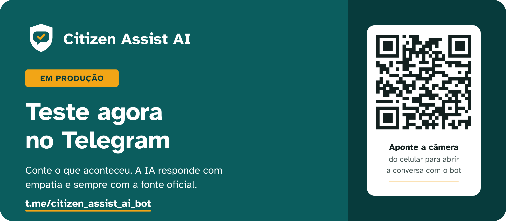
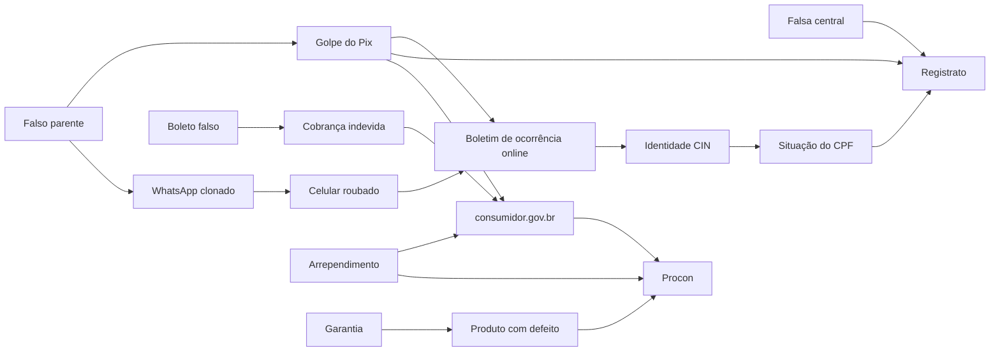

<p align="center">
  <picture>
    <source media="(prefers-color-scheme: dark)" srcset="assets/logo/citizen-assist-logo-reverse.svg">
    
  </picture>
</p>

<p align="center"><b>Orientação simples e verificada contra golpes digitais.</b><br>
Golpes digitais · direitos do consumidor · documentos, sempre com a fonte oficial.</p>

<p align="center">
  <a href="https://t.me/citizen_assist_ai_bot"></a>
  
  
  
</p>

<p align="center"><b>Global Solution 2026.2 (CitizenTech) · FIAP · Ciência da Computação · Fase 7 · Grupo 17</b></p>

---

## Teste agora: o bot está em produção no Telegram

<a href="https://t.me/citizen_assist_ai_bot"></a>

O **Citizen Assist AI** está publicado e funcionando 24 horas por dia em [**t.me/citizen_assist_ai_bot**](https://t.me/citizen_assist_ai_bot). Ele roda em servidor próprio, com deploy pelo **Dokploy** a partir deste repositório (Dockerfile). No celular, aponte a câmera para o QR Code acima.

**Como testar:**

1. Abra o bot e toque em **Iniciar** (`/start`). Ele já recebe você com uma mensagem de boas-vindas.
2. Conte sua situação do seu jeito, por exemplo:
   - *"caí num golpe do pix, o que eu faço?"*
   - *"meu filho mandou mensagem de um número novo pedindo dinheiro"*
   - *"comprei pela internet e quero devolver"*
   - *"e se o banco não resolver?"* (o bot lembra da conversa)
3. Teste também os limites: pergunte algo fora dos temas (*"como tiro passaporte?"*) ou tente enviar um CPF.

A conversa é feita pela IA (**Claude Haiku 5.5**), em tom acolhedor e **usando apenas a base verificada**, sempre com a fonte oficial no fim da resposta. É um projeto acadêmico e **não é canal oficial**: não envie dados pessoais.

## Equipe

**Grupo 17**

| Integrante | RM | GitHub |
|---|---|---|
| Carlos Eugênio Rodrigues de Andrade Filho | RM570285 | [carloseugenioandrade](https://github.com/carloseugenioandrade) |
| Emanuel Batista Braga Domingues | RM569732 | [Emanu06](https://github.com/Emanu06) |
| Leonardo Tims Carneiro Campello | RM571048 | [timsleo](https://github.com/timsleo) |
| Matheus Fuchelberguer Neves | RM571321 | [Fuchens28](https://github.com/Fuchens28) |
| Rodrigo Gomes Dias | RM569142 | [rodrigogmdias](https://github.com/rodrigogmdias) |

## Vídeo de apresentação

YouTube (não listado): **LINK_DO_VIDEO**

---

## 1. Problema, público beneficiado e temas

**O problema na vida real.** O Brasil registrou **2.261.055 estelionatos em 2025**, cerca de 258 golpes por hora. Os estelionatos por meio eletrônico chegaram a **346.753 registros**, uma alta de **20,6%** em relação a 2024 (Fórum Brasileiro de Segurança Pública, *Anuário Brasileiro de Segurança Pública 2026*, Tabela 17). Quando a pessoa cai em um golpe ou tem um problema com uma compra, a informação sobre o que fazer está espalhada entre Banco Central, bancos, Procon, polícia e gov.br, muitas vezes com termos difíceis. E alguns direitos têm prazo, como o pedido de devolução de um Pix pelo MED.

**Cidadão beneficiado.** Adultos e idosos com pouca familiaridade digital que usam Pix e WhatsApp no dia a dia. Persona: *Dona Maria, 67 anos, recebeu uma mensagem do "filho", com número novo, pedindo um Pix urgente.*

**Temas abordados (3 temas, 16 orientações):**

| Tema | Orientações |
|---|---|
| Golpes digitais | Golpe do Pix (MED), falso parente no WhatsApp, WhatsApp clonado, boleto falso, falsa central do banco, celular roubado (Celular Seguro) |
| Direitos do consumidor | Direito de arrependimento, garantia legal, produto com defeito, cobrança indevida, consumidor.gov.br, Procon |
| Documentos e registros | Boletim de ocorrência online, Carteira de Identidade Nacional, situação do CPF, Registrato (contas e chaves Pix no seu nome) |

**ODS conectados (Agenda 2030 da ONU):**

- **ODS 10, Redução das desigualdades (principal):** quem tem menos letramento digital é mais exposto a golpes e conhece menos os próprios direitos. O assistente traduz a orientação oficial para linguagem simples.
- **ODS 4, Educação de qualidade (meta 4.4, habilidades digitais):** ensina a reconhecer golpes de Pix, WhatsApp e boleto.
- **ODS 11, Cidades e comunidades sustentáveis:** amplia o acesso a serviços urbanos (Procon, delegacia online, documentos).
- *Conexão adicional:* ODS 16 (acesso à justiça e à informação, metas 16.3 e 16.10).

**Ecossistema.** O assistente **encaminha** o cidadão para os canais oficiais: Banco Central (MED, Registrato), bancos, Procon, consumidor.gov.br, Polícia Civil (boletim de ocorrência online), Receita Federal e gov.br. Ele não substitui nenhum desses canais e não se apresenta como canal oficial.

## 2. Organização da base de conhecimento, estruturas e estratégia de busca

### Base de conhecimento (`data/base_conhecimento.json`)

Cada orientação é um objeto JSON com os campos:

| Campo | Obrigatório | Descrição |
|---|---|---|
| `id` | sim | Identificador único (GOL = golpes, CON = consumidor, DOC = documentos) |
| `tema` | sim | Tema da orientação, usado na hierarquia do menu |
| `titulo` | sim | Nome curto do assunto |
| `pergunta` | não | Pergunta típica do cidadão |
| `palavras_chave` | sim | Lista de palavras e expressões usadas pela busca |
| `orientacao` | sim | Orientação resumida em linguagem simples |
| `referencia` | sim | Nome da fonte oficial consultada |
| `link` | sim | Endereço da fonte verificável |
| `data_verificacao` | sim | Data em que a fonte foi conferida (2026-11-17) |
| `confirmar` | não | `true` quando o assunto exige confirmação no canal oficial (prazos e procedimentos que mudam) |
| `relacionados` | não | Lista de `id` de assuntos relacionados (arestas do grafo) |

**Origem das orientações:** todas foram conferidas em páginas oficiais ou institucionais: Banco Central (Guia do MED e Registrato), Planalto (Código de Defesa do Consumidor, Lei 8.078/1990), consumidor.gov.br, Febraban, Central de Ajuda do WhatsApp, Ministério da Justiça (Celular Seguro), Receita Federal e gov.br.

**Validação ao carregar:** o programa trata arquivo ausente, arquivo vazio ou com JSON inválido, registros sem campos obrigatórios (o registro é ignorado com aviso), identificadores repetidos e relacionados que apontam para `id` inexistente. Para **acrescentar ou corrigir** orientações, basta editar o JSON ou usar a opção 5 do menu, sem alterar as regras do programa.

### Estruturas de dados

- **Lista de dicionários:** a base inteira (cada orientação é um dicionário).
- **Dicionário `indice` (id → orientação):** recupera uma orientação pelo identificador em tempo constante.
- **Dicionário `temas` (tema → lista de orientações):** hierarquia de dois níveis, **Tema → Assunto**, usada no menu de temas.
- **Grafo por lista de adjacência:** o campo `relacionados` liga cada assunto a outros 2 ou 3. Ele representa o caminho que acontece na vida real: depois de um golpe, a pessoa precisa registrar o boletim de ocorrência, verificar contas no seu nome e reclamar com o banco.



Depois de cada resposta, o assistente mostra os vizinhos do grafo como **"Assuntos relacionados para continuar a consulta"**, e o usuário navega entre os assuntos digitando o número. Exemplo: Golpe do Pix → Registrato → Situação do CPF.

### Estratégia de busca

1. **Normalização:** a pergunta é convertida para minúsculas, sem acentos e sem pontuação.
2. **Extração de palavras:** são descartadas as palavras com até 2 letras e as palavras vazias ("como", "para", "meu" etc.). Em seguida, um radical simples remove o plural ("golpes" → "golpe", "devoluções" → "devolucao").
3. **Pontuação (busca sequencial):** cada orientação recebe **+2 pontos** por palavra do usuário encontrada nas palavras-chave e **+1** por palavra encontrada no título ou na pergunta típica.
4. **Decisão:**
   - pergunta vazia → aviso de entrada vazia;
   - maior pontuação **menor que 2** → **sem resposta confiável** (o assistente não inventa e sugere temas e palavras);
   - **várias orientações empatadas** na maior pontuação → **consulta ambígua**: o assistente lista as opções e pergunta qual o usuário procura;
   - uma única orientação com a maior pontuação → resposta.

**Quando há várias correspondências**, vence a orientação de maior pontuação. As palavras-chave valem o dobro porque são termos escolhidos de propósito para cada assunto. Empates não são decididos pelo sistema; quem escolhe é o usuário.

## 3. Regras de resposta, prompts e tratamento das limitações

- **Dois modelos de instrução de resposta**, detalhados em [`docs/prompts.md`](docs/prompts.md):
  - **Modelo A (direto):** orientação + nome da fonte;
  - **Modelo B (estruturado, padrão):** persona de assistente informativo não oficial, formato fixo (Assunto, O que fazer, Fonte com link, Data de verificação, Avisos) e regras explícitas (citar a fonte, não inventar, não pedir dados pessoais).
  - **Modelo C (chat com IA, opção 7):** as regras do Modelo B aplicadas como prompt de sistema para o Claude Haiku 5.5, junto com a base verificada.
- **Comparação:** o Modelo B atende 100% dos critérios de transparência (link, data, assunto, aviso não oficial), contra 0% do Modelo A, ao custo de respostas cerca de 66% mais longas. Por isso ele é o padrão, e o modelo pode ser trocado pela opção 6 do menu.
- **Avisos:** os 6 assuntos marcados com `confirmar: true` mostram "Confirme no canal oficial antes de agir", e toda resposta do Modelo B informa que o assistente não é canal oficial.
- **Limitações tratadas:** entrada vazia, opção de menu inexistente ou em branco, pergunta sem correspondência (com sugestão de temas e palavras), consulta ambígua e base inválida.

## 4. Plano de testes, indicadores e interpretação

Detalhes em [`docs/testes.md`](docs/testes.md). Os testes automáticos da base rodam pela opção **3** do menu (gera `data/resultados_testes.csv` e `data/comparacao_modelos.csv`). O teste de usabilidade é feito com uma pessoa real no **bot do Telegram em produção**.

| Indicador | Resultado |
|---|---|
| Perguntas de teste | 20 (5 diretas, 8 reformulações, 3 fora do tema, 4 casos-limite) |
| Taxa de acerto | **95,0%** (19/20) |
| Tempo médio de consulta | cerca de 0,4 ms (máximo abaixo de 1 ms) |
| Facilidade de uso (bot do Telegram) | 2 usuários reais: **nota 5 de 5** em facilidade, clareza, acolhimento e confiança; os 2 perceberam a fonte oficial; ponto de melhoria: respostas longas para o celular (ver `docs/testes.md`, seção 6) |

**Interpretação:** a busca acertou todas as perguntas diretas e reformuladas e **não inventou resposta** para nenhuma pergunta fora do tema. O único erro (T18, a palavra solta "golpe") mostra que a ambiguidade só é detectada quando há empate de pontuação. **Melhorias:** (1) tratar perguntas genéricas de uma palavra mostrando os assuntos do tema; (2) dicionário de sinônimos e tolerância a erros de digitação; (3) testar com perguntas de usuários reais. **Limitação da avaliação:** as perguntas foram escritas pela própria equipe, e a amostra é pequena.

## 5. Como executar

Requisito: Python 3.12 ou superior. O assistente principal usa apenas `json`, `os` e `time`. As bibliotecas `anthropic` (chat com IA, opções 7 e 8) e `requests` (bot do Telegram, opção 8) são instaladas com `uv sync`.

```bash
python src/sistema.py
```

Ou, com o uv:

```bash
uv run src/sistema.py
```

Execute a partir da pasta raiz do projeto (onde fica este README).

**Menu:**

```text
1 - Escolher um tema
2 - Fazer uma pergunta
3 - Executar testes e indicadores
4 - Avaliar a facilidade de uso
5 - Adicionar orientação à base
6 - Trocar modelo de resposta (atual: B)
7 - Conversar com a IA (chat com claude-haiku-5-5)
8 - Iniciar o bot do Telegram
0 - Sair
```

### Bot do Telegram (opção 8, opcional)

A opção 8 coloca o assistente para funcionar como **bot do Telegram** ([@citizen_assist_ai_bot](https://t.me/citizen_assist_ai_bot), **em produção**), para o cidadão usar pelo celular, onde já está acostumado a conversar. No Telegram, a conversa é **sempre pela IA** (Claude Haiku 5.5, com as regras do Modelo C e a base verificada), para que o atendimento seja **humanizado**: acolhedor, com empatia, em linguagem simples e sem comandos para decorar.

1. No Telegram, fale com o **@BotFather**, envie `/newbot`, escolha um nome e copie o **token** gerado.
2. Defina o token do Telegram e a chave da Anthropic (as duas são obrigatórias para o bot):
   - PowerShell: `$env:TELEGRAM_BOT_TOKEN = "seu-token"; $env:ANTHROPIC_API_KEY = "sua-chave"`
   - Bash: `export TELEGRAM_BOT_TOKEN="seu-token" ANTHROPIC_API_KEY="sua-chave"`
3. Rode `uv run src/sistema.py` e escolha a opção **8**. O bot fica ativo até você pressionar **Ctrl+C**.

**Como é a conversa:**

| Mensagem | O que acontece |
|---|---|
| `/start` (ao abrir o bot) | A pessoa já é **recebida com uma mensagem de boas-vindas** gerada pela IA: apresentação, temas em que pode ajudar, aviso de que não é canal oficial e pedido para não enviar dados pessoais. Se a IA falhar, o bot envia uma saudação padrão. |
| qualquer texto ("caí num golpe do pix") | A IA responde com empatia, usando só a base verificada e terminando com a fonte e o link. A conversa mantém o histórico, então perguntas de continuidade funcionam. |
| mensagem com CPF, telefone ou e-mail | Não é enviada à IA; o bot pede para a pessoa reescrever sem dados pessoais. |
| figurinha, foto, áudio | O bot avisa que, por enquanto, só lê texto. |

**Rodar o bot sem o menu, em Docker (deploy no Dokploy):** o arquivo `src/bot_telegram.py` inicia direto o bot, e o `Dockerfile` empacota o projeto com `uv`.

```bash
docker build -t citizen-assist-bot .
docker run -e TELEGRAM_BOT_TOKEN="seu-token" -e ANTHROPIC_API_KEY="sua-chave" citizen-assist-bot
```

No Dokploy, o bot roda como uma *Application* com o build type **Dockerfile**, a partir deste repositório no GitHub. As variáveis `TELEGRAM_BOT_TOKEN` e `ANTHROPIC_API_KEY` são definidas na aba *Environment*. O bot não precisa de porta nem de domínio, porque usa *long polling*.

**Como funciona:** o bot usa a API HTTP do Telegram por *long polling* (`getUpdates`), com a biblioteca `requests`, sem servidor nem webhook, e reaproveita a mesma função do chat do terminal (`perguntar_ia`). O histórico de cada pessoa fica em um dicionário `conversas` (chat → lista de mensagens), só na memória, e é reiniciado a cada `/start`. O bot **não grava as mensagens**. No terminal, aparece apenas o tempo de resposta e a **conferência com a base** (os ids das orientações verificadas que a busca local encontra para a mesma pergunta, ex.: `GOL01`), que permite confrontar as respostas da IA com a base sem expor o conteúdo da conversa.

### Chat com IA (opção 7, opcional)

A opção 7 abre um chat com o modelo **Claude Haiku 5.5** (`claude-haiku-5-5`), da Anthropic. As opções 1 a 6 funcionam sem internet e sem chave; só o chat precisa delas.

1. Instale as dependências: `uv sync` (ou `pip install anthropic`).
2. Defina a chave da API:
   - PowerShell: `$env:ANTHROPIC_API_KEY = "sua-chave"`
   - Bash: `export ANTHROPIC_API_KEY="sua-chave"`
3. Rode `uv run src/sistema.py`, escolha a opção **7** e digite `sair` para voltar ao menu.

**Como a IA é limitada à base verificada (RAG simples):**

- A instrução do sistema leva a base `data/base_conhecimento.json` inteira e as regras do **Modelo C** (ver [`docs/prompts.md`](docs/prompts.md)): responder **somente** com a base, terminar com "Fonte: ... - link", dizer quando não sabe, não pedir dados pessoais e não se apresentar como canal oficial.
- A conversa mantém o histórico, então o usuário pode fazer perguntas de continuidade ("e se o banco não resolver?").
- **Conferência com a base:** depois de cada resposta da IA, o sistema roda a busca por palavras-chave na mesma pergunta e mostra quais orientações verificadas (id, título e link) correspondem a ela, ou avisa que nenhuma corresponde. Assim a resposta gerada é sempre confrontada com a base verificada, como pede o enunciado.
- **Privacidade:** mensagens que parecem conter CPF, telefone ou e-mail **não são enviadas** à API. O chat avisa que as mensagens vão para a Anthropic.
- **Erros tratados:** biblioteca não instalada, chave ausente ou inválida, limite de requisições, falta de conexão, erro da API e recusa do modelo.

## 6. Exemplos de perguntas, respostas e entradas inválidas

**Pergunta com resposta e navegação:**

```text
Digite sua pergunta: caí num golpe do pix
----------------------------------------------------------------------
Assunto: Golpes digitais > Caí em um golpe pelo Pix
O que fazer: Avise seu banco na hora, pelo aplicativo (opção de contestar o Pix no extrato) ou pelos
canais oficiais, e peça a devolução pelo MED (Mecanismo Especial de Devolução). O pedido pode ser feito
em até 80 dias, mas quanto antes, maior a chance de recuperar o dinheiro. [...]
Fonte: Banco Central do Brasil - Guia do MED (Mecanismo Especial de Devolução) - https://www.bcb.gov.br/content/estabilidadefinanceira/pix/Guia_MED.pdf
Informação verificada em: 2026-11-17
Atenção: regras e prazos podem mudar. Confirme no canal oficial antes de agir.
O Citizen Assist AI é um projeto acadêmico informativo e não é canal oficial de nenhum órgão público ou empresa.
----------------------------------------------------------------------
Assuntos relacionados para continuar a consulta:
    1 - Registrar boletim de ocorrência online
    2 - Ver contas, chaves Pix e empréstimos no seu nome (Registrato)
    3 - Reclamar no consumidor.gov.br
```

**Consulta ambígua:**

```text
Digite sua pergunta: whatsapp
Sua pergunta combina com mais de um assunto. Qual deles você procura?
    1 - Golpe do falso parente no WhatsApp
    2 - WhatsApp clonado ou invadido
```

**Pergunta sem resposta confiável:**

```text
Digite sua pergunta: como tirar passaporte
Não encontrei uma orientação confiável na base para essa pergunta.
Prefiro não inventar uma resposta. Você pode:
    - usar palavras como: pix, golpe, boleto, whatsapp, garantia, arrependimento, cobrança, documento, boletim de ocorrência;
    - escolher um dos temas disponíveis: Golpes digitais, Direitos do consumidor, Documentos e registros;
    - procurar diretamente o canal oficial do órgão ou da empresa.
```

**Entradas inválidas:**

```text
Digite sua pergunta:
Você não digitou nenhuma pergunta. Tente, por exemplo: 'caí num golpe do pix'.

Escolha uma opção: 9
Opção inexistente. Digite um número de 0 a 6.

Digite sua pergunta: meu cpf 123.456.789-00 está suspenso
Por segurança, não digite CPF, telefone, e-mail ou outros dados pessoais.
Reescreva a pergunta sem essas informações.
```

## 7. Clareza, acessibilidade, privacidade e informação não oficial

- **Clareza e acessibilidade:** orientações em linguagem simples, frases curtas e passos concretos; menu numerado (só exige digitar números); interface de texto, que funciona em qualquer computador e é compatível com leitores de tela.
- **Privacidade:** o assistente **não pede nenhum dado pessoal**, não guarda as perguntas (no chat com IA, as mensagens são enviadas à API da Anthropic, e o usuário é avisado disso) e bloqueia perguntas que parecem conter CPF, telefone ou e-mail (8 ou mais dígitos ou "@"). A avaliação de uso guarda apenas a nota e um comentário sem dados pessoais.
- **Informação não oficial:** toda resposta cita a fonte oficial com link e data de verificação, informa que o assistente não é canal oficial e, nos assuntos com prazos que mudam, pede confirmação no canal oficial. O assistente nunca promete integração com órgãos públicos.

## 8. Estrutura do repositório

```text
gs-citizen-assist/
├── README.md
├── assets/
│   ├── banner-bot-telegram.png    # banner do bot com QR Code (identidade visual)
│   ├── capa-bot-telegram.png      # imagem de descrição do bot no Telegram
│   └── logo/                      # logo, símbolo e avatar oficiais da marca
├── pyproject.toml                 # metadados do projeto e autores (uv)
├── src/
│   └── sistema.py                 # programa principal (menu, busca, respostas, testes)
├── data/
│   ├── base_conhecimento.json     # 16 orientações verificadas em 3 temas
│   ├── perguntas_teste.json       # 20 perguntas de teste com resposta esperada
│   ├── resultados_testes.csv      # gerado pela opção 3
│   └── comparacao_modelos.csv     # gerado pela opção 3
└── docs/
    ├── prompts.md                 # modelos de instrução A e B e comparação
    ├── testes.md                  # plano de testes, indicadores e usabilidade
    └── uso_ia.md                  # uso de IA e validação crítica
```

## 9. Conclusões, limitações e melhorias

O Citizen Assist AI mostra que, com fundamentos de programação (listas, dicionários, funções, arquivos JSON, tratamento de erros), uma busca simples por pontuação e um grafo de assuntos, é possível construir um assistente útil e **transparente**: ele responde com fonte verificável, avisa quando não sabe e conduz o cidadão ao próximo passo.

**Limitações:** a base é pequena (16 orientações) e precisa de revisão periódica, porque regras como as do MED do Pix mudam; a busca depende de palavras-chave e não entende sinônimos que não foram cadastrados; o boletim de ocorrência online varia de estado para estado; e os testes foram escritos pela própria equipe.

**Melhorias futuras:** sinônimos e tolerância a erros de digitação; tratamento de perguntas genéricas; aviso automático quando a data de verificação passar de 6 meses; mensagens de voz no bot do Telegram e versão por WhatsApp para ampliar a acessibilidade; e uma avaliação automática das respostas do chat com IA (verificar se o link citado é o mesmo da orientação encontrada pela busca).
